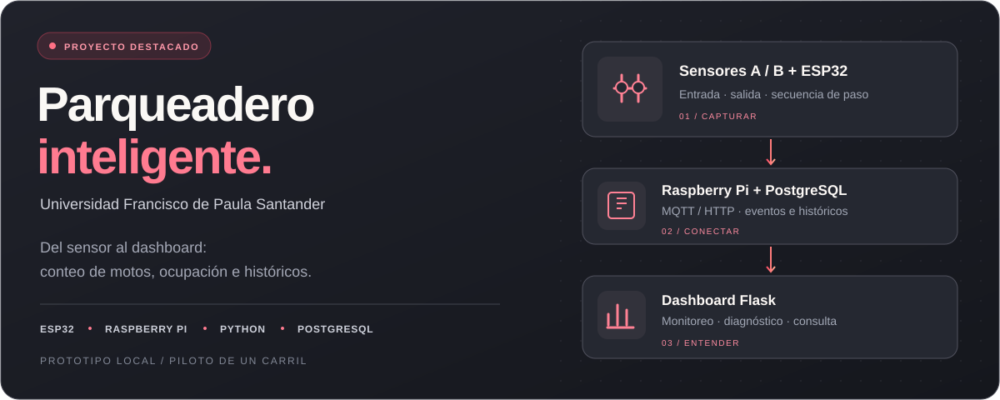

  

  <a href="#proyecto-destacado">Proyecto destacado</a> ·
  <a href="#lo-que-construyo">Mis proyectos</a> ·
  <a href="#mi-caja-de-herramientas">Tecnologías</a>

## Hola, soy Deylla

Soy **ingeniero electrónico** y me gusta conectar el software con cosas que pasan fuera de la pantalla: sensores, datos, procesos y personas. Aquí comparto mis proyectos de IoT, desarrollo web y videojuegos, junto con lo que voy aprendiendo al construirlos.

**Mi proyecto principal es Parqueadero Inteligente UFPS:** un prototipo que une electrónica, comunicación y visualización de datos.

## Proyecto destacado

### Parqueadero Inteligente UFPS

Prototipo local para contar entradas y salidas de motocicletas y consultar la ocupación del parqueadero de la **Universidad Francisco de Paula Santander**.

- **Hardware y comunicación:** sensores A/B, ESP32 y Raspberry Pi, con rutas de integración MQTT y HTTP.
- **Datos e interfaz:** PostgreSQL y dashboard Flask para ocupación, históricos y diagnóstico de nodos.
- **Análisis:** entrenamiento independiente de regresión lineal, Random Forest y MLP.
- **Documentación:** guías de montaje, demostración, operación y uso.

> El montaje físico es un piloto de un carril. La representación de nueve carriles y 18 zonas es lógica; los modelos y métricas se documentan por separado.

**[Explorar el proyecto ↗](https://github.com/deyson24ivan/parqueadero-inteligente-ufps)** &nbsp;·&nbsp; **[Ver la arquitectura](https://github.com/deyson24ivan/parqueadero-inteligente-ufps/blob/main/docs/arquitectura.md)** &nbsp;·&nbsp; **[Manuales y entregables](https://github.com/deyson24ivan/parqueadero-inteligente-ufps/blob/main/docs/entrega_proyecto.md)**

## Lo que construyo

| Proyecto | Qué estoy construyendo | Enlaces |
| :--- | :--- | :--- |
| **Parqueadero Inteligente UFPS** | Un puente entre sensores, eventos y una interfaz para consultar ocupación. | [Repositorio](https://github.com/deyson24ivan/parqueadero-inteligente-ufps) |
| **FUTIN** | Un juego de fútbol web con cartas, modo carrera, minijuegos y pase de temporada. React, TypeScript y Vite. | [Repositorio](https://github.com/deyson24ivan/Futin) |
| **Electropatios** | Un proyecto de portafolio de cotización de materiales eléctricos, catálogo y automatización comercial. | [Repositorio](https://github.com/deyson24ivan/electropatios-quote-system) · [Demo](https://deyson24ivan.github.io/electropatios-quote-system/) |

## Mi caja de herramientas

**Software y datos**

  
  
  
  
  
  

**Hardware y herramientas**

  
  
  
  
  

Son tecnologías presentes en mis proyectos; mi objetivo es seguir entendiendo cómo encajan y mejorar con cada implementación.

---

  <b>Una idea, un prototipo, una mejora a la vez.</b> 
  <a href="https://github.com/deyson24ivan?tab=repositories">Ver todos mis repositorios ↗</a>

